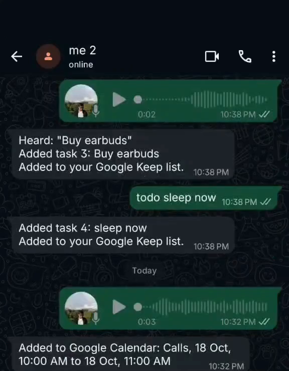
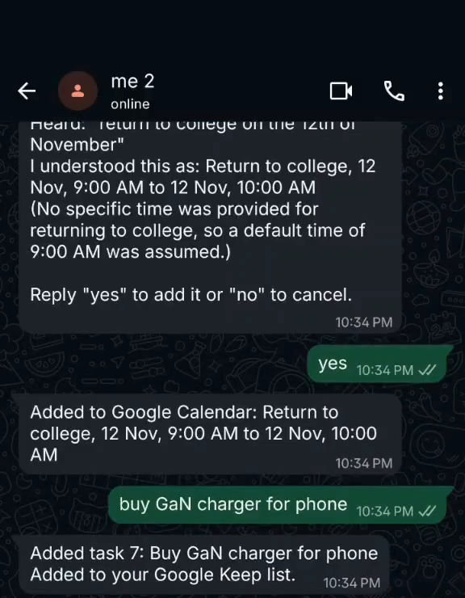
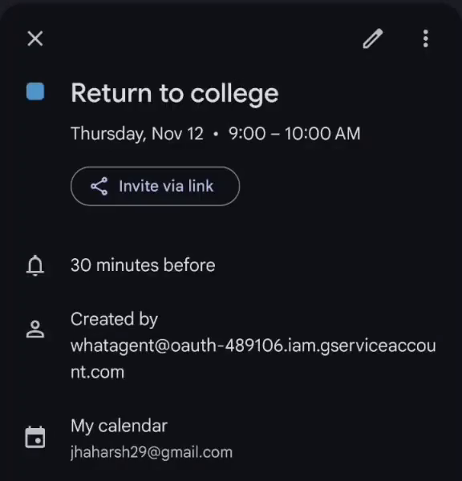
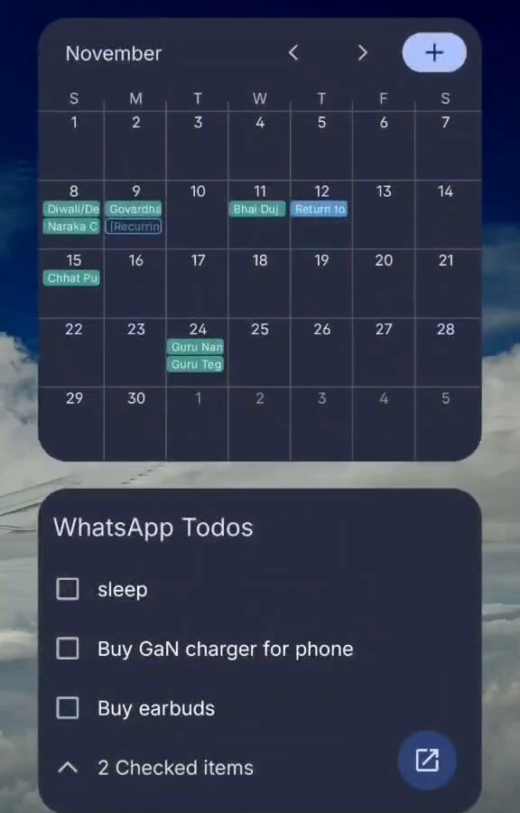
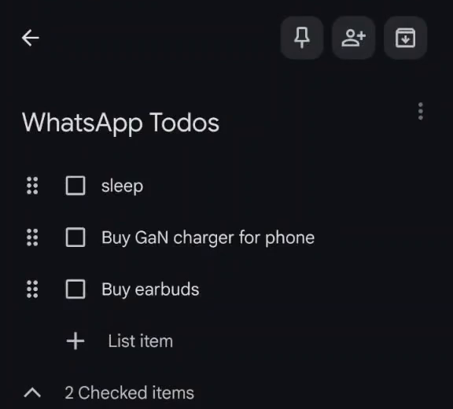

# whatagent

text yourself on whatsapp, and it ends up in your google calendar or your todo list. voice notes work too.

## why this exists

i wanted something like the Essential Space on Nothing phones: throw a thought somewhere and get it back when it matters. my sticky notes weren't on the cloud, and i forget a lot of stuff, so i built this.

funny enough, i now have a Nothing phone with Essential Space on it. i still use this though. whatsapp is open all day anyway, and texting yourself is about the lowest-effort way to keep track of things.

## what it does

- "dentist tomorrow at 5" goes straight into google calendar (or, if you skip calendar, becomes a todo with a whatsapp reminder 30 minutes before)
- "buy earbuds" or "remind me to call abhinav at 6" becomes a todo, and you get a whatsapp reminder when it's time
- voice notes work exactly like text, so you can just talk
- todos can also land on one google keep checklist ("WhatsApp Todos"), if you set that up
- repeating stuff works: "every wednesday at 3pm, nptel assignment" becomes a weekly event
- if a time is vague, it tells you what it understood and waits for a yes or no
- it only listens to your own self-chat (message yourself) and ignores every other chat

## see it in action

a voice note about going back to college turns into a calendar event (after a quick yes), a typed "buy GaN charger for phone" turns into a todo, and both show up in google calendar and on the keep checklist.

<p align="center">
  
  
</p>
<p align="center">
  
  
  
</p>

https://github.com/user-attachments/assets/96357914-06af-41dc-8b21-0f80a32008cb

## how it works

```text
your self-chat -> whatsapp (linked device) -> gemini (event or todo?) -> checks in rust -> google calendar, or your todo list (+ google keep)
```

it's a small rust program that runs on a server and shows up in whatsapp as a linked device, like whatsapp web. gemini reads your message (or listens to your voice note) and works out what you meant. rust then checks the result before anything gets created, so a weird answer from the model can't make a mess of your calendar.

## heads up

- whatsapp has no official API for personal accounts, so this uses [whatsapp-rust](https://github.com/jlucaso1/whatsapp-rust), an unofficial client that connects like whatsapp web. it only reads and writes your own self-chat, but whatsapp doesn't officially allow unofficial clients, so in theory your number could get flagged. it's been fine for me so far, but use it at your own risk
- google keep works the same way: unofficial, through [gkeepapi](https://github.com/kiwiz/gkeepapi). google may make you sign in again now and then, or it may stop working someday
- the keep code and the calendar code are like passwords for your google account. keep them to yourself
- gemini reads your messages to understand them, so they go to google. don't text yourself anything you wouldn't want there

## setting it up

you need:

- a linux server that stays on. the cheapest VPS works, and so does a free oracle cloud one: [docs/FREE_SERVER.md](docs/FREE_SERVER.md) walks you through getting one, no linux experience needed. prebuilt binaries cover x86_64 and ARM64 with glibc 2.35+ (ubuntu 22.04+, debian 12+)
- a free gemini API key from [google ai studio](https://aistudio.google.com/apikey) (or from the cloud shell step below)

that's it. google calendar and google keep are optional, and the installer asks about both.

### one command on the server

```bash
ssh you@your-server
curl -fsSL https://raw.githubusercontent.com/life2harsh/whatagent/main/deploy/install.sh | sudo bash
```

the installer:

1. downloads the latest release for your CPU and checks its checksum
2. creates the `wa-calendar` user and `/opt/wa-calendar-agent`, and installs the systemd service
3. asks for your gemini key (and checks it works) and your timezone
4. asks if you want google calendar and google keep (both optional, see below)
5. shows a QR code: scan it under whatsapp > settings > linked devices
6. asks you to message yourself once, so it knows which chat is yours
7. starts the service and waits until it's connected

### google calendar (optional)

without it, events become todos with a whatsapp reminder, which is honestly enough for a lot of people. with it, they land in your real calendar.

the easy way takes about two minutes and needs no clicking around google cloud:

1. open [google cloud shell](https://shell.cloud.google.com/?show=terminal) (a free terminal in your browser, signed in to your google account) and paste:

   ```bash
   curl -fsSL https://raw.githubusercontent.com/life2harsh/whatagent/main/deploy/google-setup.sh | bash
   ```

   it sets up a google cloud project for you and prints a **gemini key** and a **calendar code**. no billing or card needed
2. share your calendar with the email it shows (it prints the exact steps)
3. paste the code when the installer asks about google calendar. already installed? run the installer again with `--calendar`

the calendar code works like a password, so don't share it. if you'd rather click through google cloud yourself, [docs/GOOGLE_SETUP.md](docs/GOOGLE_SETUP.md) has the manual steps, and the installer also takes a key file path instead of a code.

### google keep (optional)

todos can also go on one google keep checklist ("WhatsApp Todos"). say yes when the installer asks, or add it later with `--keep`. it then asks for a keep code, which you get on your own computer (not the server):

- **windows:** download `keep-signin-windows.exe` from the [latest release](https://github.com/life2harsh/whatagent/releases/latest) and open it
- **mac or linux:** run `curl -fsSL https://raw.githubusercontent.com/life2harsh/whatagent/main/deploy/keep-signin.sh | bash`

a small window opens: type your gmail, sign in, click "I agree", and copy the code it shows into the installer. the code works like a password, so don't share it. more in [docs/GOOGLE_SETUP.md](docs/GOOGLE_SETUP.md).

### or from your own machine

if you have this repo on your computer, `deploy/deploy.sh` does the same thing over SSH (and uploads the calendar key for you):

```bash
deploy/deploy.sh you@your-server -i ~/.ssh/my-key
deploy/deploy.sh you@your-server -i ~/.ssh/my-key --service-account ./service-account.json
```

add `--binary path/to/wa-calendar-agent` to deploy a binary you built yourself instead of a release. from a linux desktop, `deploy/keep-setup.sh you@your-server -i ~/.ssh/my-key` connects google keep in one go, no code to copy.

### upgrading and changing settings

run the same command again to upgrade. your settings, the whatsapp link and your todos are kept, the old binary is backed up next to the new one, and the rollback command is printed at the end. other options:

| option | what it does |
| --- | --- |
| `--calendar` | connect (or change) google calendar |
| `--keep` | connect google keep, or reconnect it when google asks you to sign in again |
| `--version v0.2.0` | install a specific release instead of the latest |
| `--reconfigure` | ask every question again |
| `--relink` | unlink whatsapp and show a new QR code |

settings live in `/etc/wa-calendar-agent.env` (after editing it, run `sudo systemctl restart wa-calendar-agent`). handy commands:

```bash
journalctl -u wa-calendar-agent -f                         # logs
sudo systemctl restart wa-calendar-agent                   # restart
sudo -u wa-calendar sh -c 'set -a; . /etc/wa-calendar-agent.env; /opt/wa-calendar-agent/wa-calendar-agent check'
```

the service is capped at 25% CPU and 512 MB of memory, so it's happy sharing a small VPS with other stuff.

## commands

mostly you just write normally. there are a few exact commands too:

```text
todo submit DBMS assignment | due 2026-09-18T17:00:00+05:30 | remind 2026-09-18T16:00:00+05:30 | note upload the PDF
tasks
done 1
remind 2026-09-18T16:00:00+05:30 | call Abhinav
```

`tasks` lists your open todos, `done 1` ticks one off (and cancels its reminder), and `remind` sets a plain reminder with no todo attached. the `todo` and `remind` commands take exact times with a timezone offset; if you'd rather say "tomorrow at 6", just write it normally.

## details

**reminders.** the service checks for due reminders every `REMINDER_POLL_SECONDS` seconds and sends them to your self-chat. if a send fails, it's retried instead of being dropped.

**google keep.** with `KEEP_BRIDGE_URL` set, every new todo is added as an unchecked item to one checklist (named by `KEEP_LIST_TITLE`, default "WhatsApp Todos") through the small `keep-bridge` service. syncing to keep is retried separately from creating the todo, so a keep hiccup never loses a todo. after changing the bridge code, redeploy it with `deploy/keep-setup.sh you@server -i key --update` (no new sign-in). ticking an item in keep doesn't mark the todo done here yet.

**calendar.** agenda text, notes and other details go into the event description. without google calendar, an event becomes a todo due when it starts, with a whatsapp reminder 30 minutes before; a repeating one only gets its first reminder. repeating events use validated RFC 5545 rules, and vague repetition ("sometimes on weekends") is rejected rather than guessed. messages that clearly aren't events or todos (links, greetings, questions) are politely declined.

**no duplicates.** every whatsapp message ID is claimed in SQLite before anything talks to google, so a replayed message is never processed twice. calendar events also get an ID based on the message ID, so even a retry after a lost response can't create a second event.

**state.** SQLite holds processing state, pending confirmations, todos and the delivery queues. it isn't a message archive. the whatsapp session lives in a separate database; treat that file like a password.

## developing locally

1. copy `.env.example` to `.env` and fill in the required values (see below)
2. get a gemini key, and set up the calendar service account if you want calendar, as in [docs/GOOGLE_SETUP.md](docs/GOOGLE_SETUP.md)
3. try it without whatsapp:

```bash
cargo run -- test-calendar "cal OSDC meeting tomorrow at 6pm"
```

this calls gemini (and google calendar, if set up) for real and prints the reply you'd get on whatsapp.

to link whatsapp and find your `OWNER_JID`, set `WHATSAPP_SESSION_DATABASE_PATH`, run `cargo run -- pair`, scan the QR code and message yourself once. it prints the exact `OWNER_JID=` line to use and exits. after that, `cargo run -- run` starts the daemon, and `cargo run -- check` tests the gemini key (and calendar access, if set up) without sending anything.

**environment.** see `.env.example`. `OWNER_JID` and `GEMINI_API_KEY` are required. `GOOGLE_SERVICE_ACCOUNT_KEY_PATH` and `GOOGLE_CALENDAR_ID` turn on google calendar (set both or neither), and `KEEP_BRIDGE_URL` and `KEEP_BRIDGE_TOKEN` turn on keep sync. don't commit `.env`, the session database or any key files.

checks:

```bash
cargo fmt --check
cargo test
cargo clippy --all-targets -- -D warnings
cargo build --release
```

### publishing releases

the installer downloads binaries from this repo's github releases, so the repo has to be public. push a version tag to build and publish them:

```bash
git tag v0.1.0
git push origin v0.1.0
```

`.github/workflows/release.yml` builds x86_64 and ARM64 binaries and attaches them to the release. forks can point the installer at their own releases with `WA_REPO=owner/repo`.

### full-pipeline checklist

- [ ] with calendar on, the service account's email has "make changes to events" on `GOOGLE_CALENDAR_ID`
- [ ] with calendar off, "dentist tomorrow at 5" becomes a todo with a reminder 30 minutes before
- [ ] `cargo run -- test-calendar "cal test event tomorrow at 6pm"` creates an event
- [ ] a deliberately vague request asks for confirmation, and `yes` creates exactly one event
- [ ] `OWNER_JID` matches the line printed by `wa-calendar-agent pair` (the installer does this for you)
- [ ] after `cargo run -- run` and scanning the QR code, the session database exists and only you can read it
- [ ] `cal test event tomorrow at 6pm` in your self-chat gets one short reply
- [ ] a voice note for an event creates one calendar event and one whatsapp confirmation
- [ ] a voice note like "remind me to buy milk tomorrow at 6pm" creates one todo (and one new keep checklist item, if keep is on)
- [ ] a clear repeating request shows up as a repeating event in google calendar
- [ ] add a todo, list it, complete it, and check that one scheduled reminder reaches your self-chat
